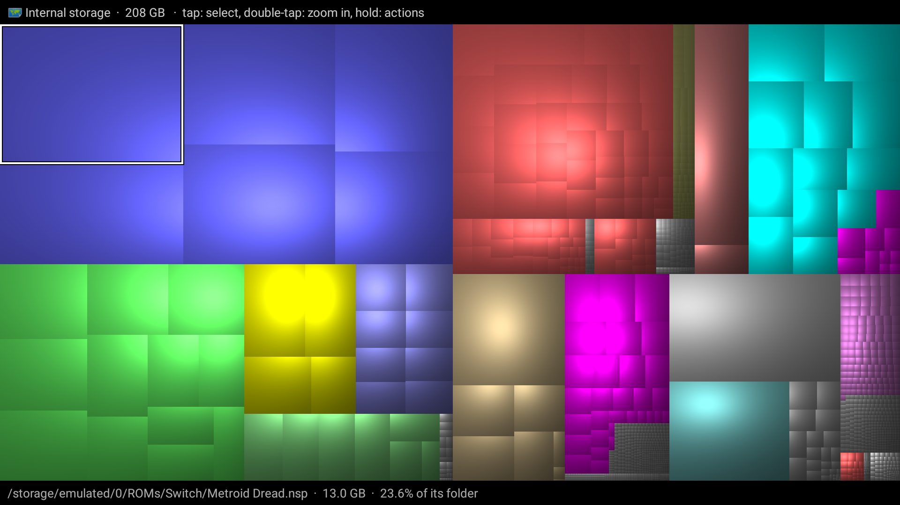
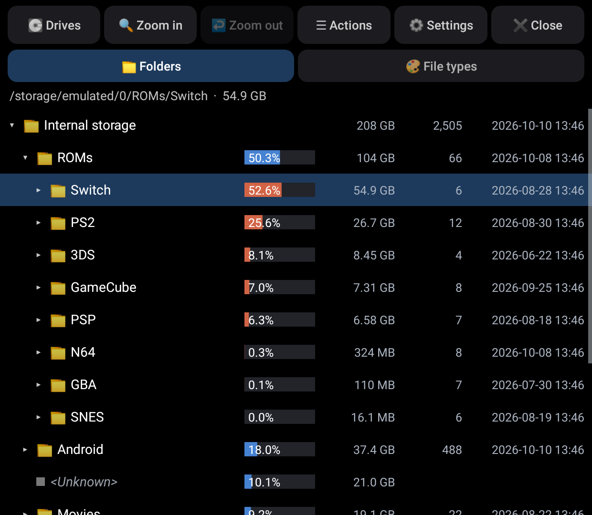
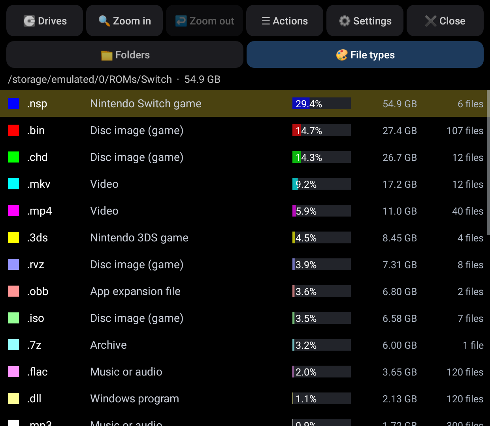
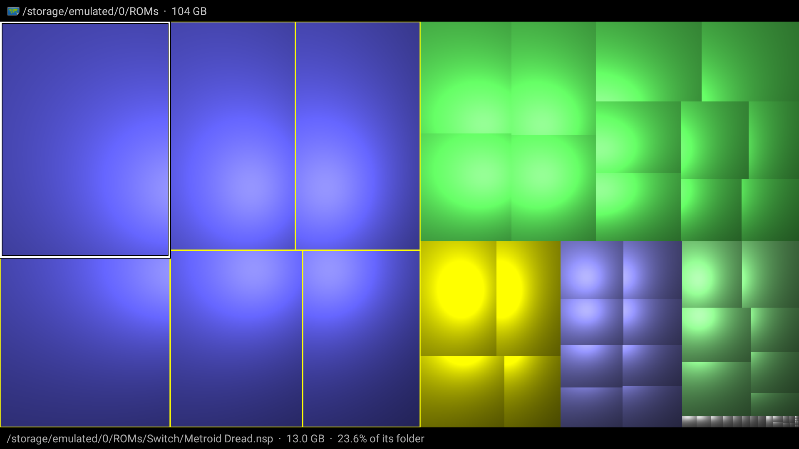
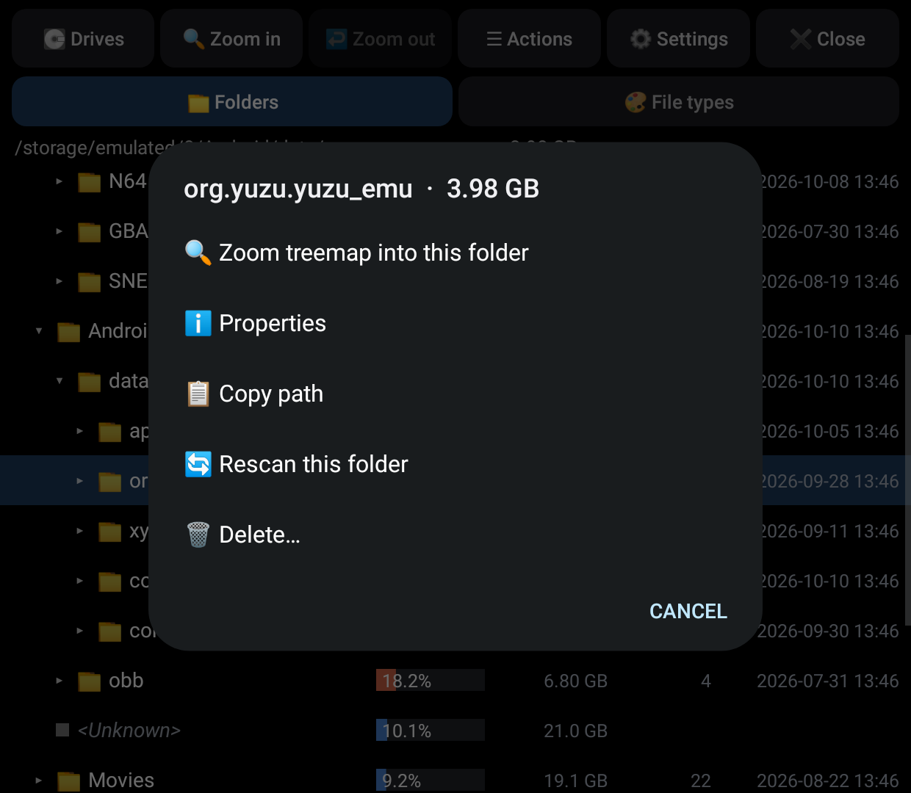
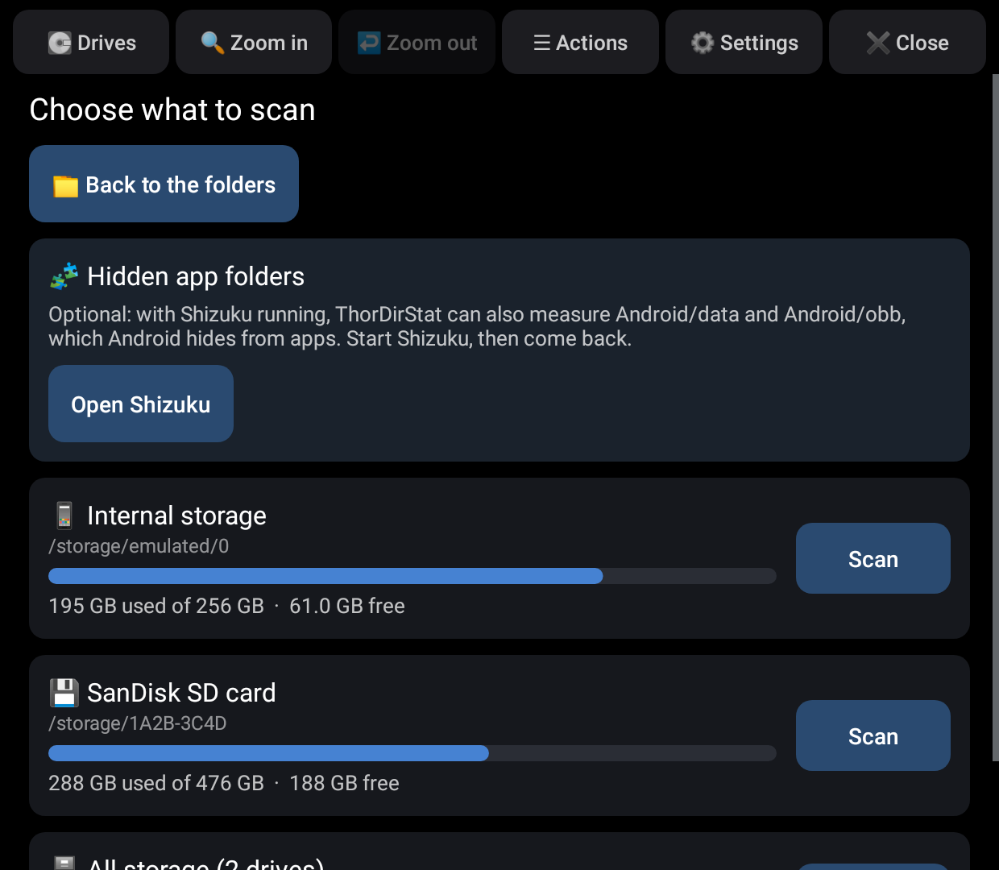
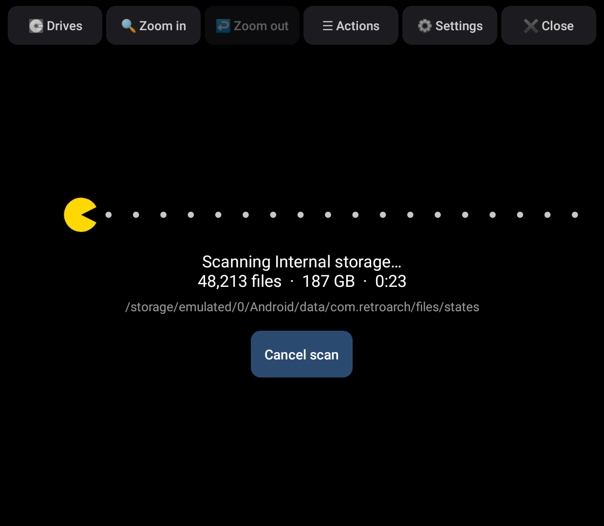
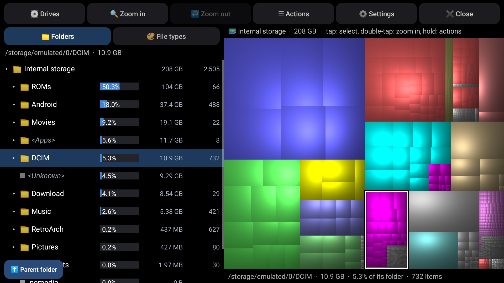
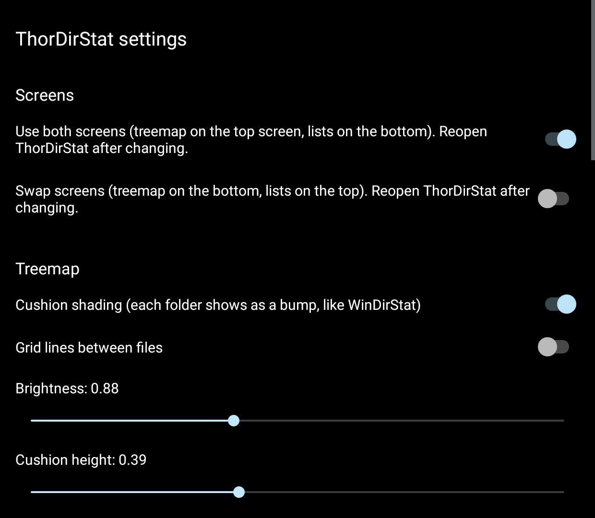
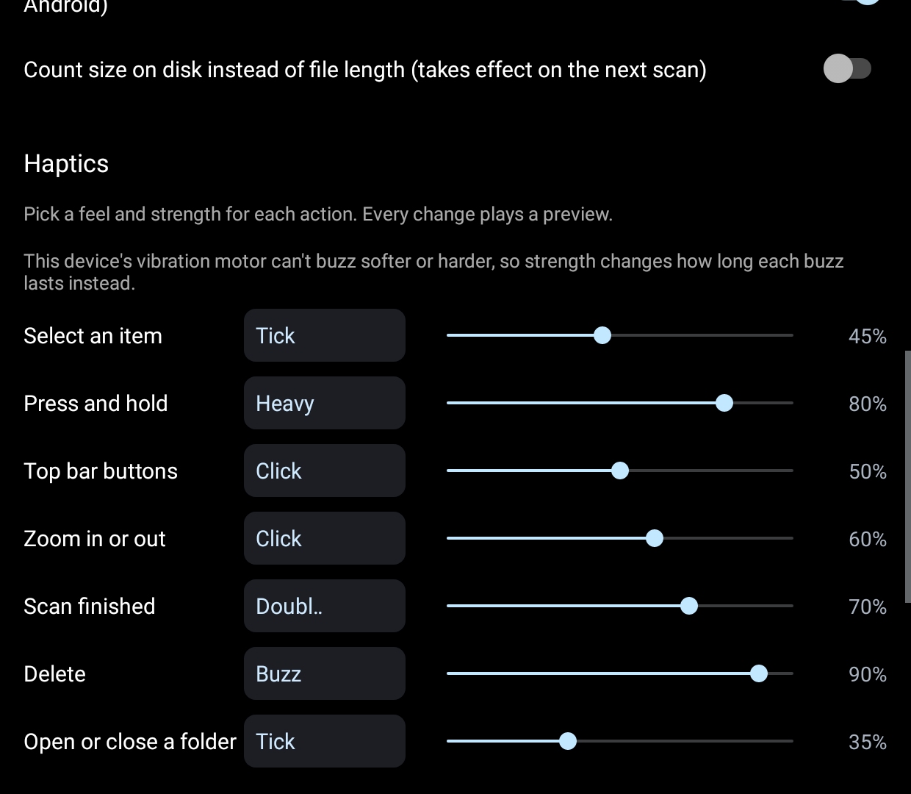

<p align="center"></p>

# ThorDirStat

[](https://github.com/ajhockey88/ThorDirStat/releases)
[](https://github.com/ajhockey88/ThorDirStat/releases/latest)

🗺️ A WinDirStat for the AYN Thor.

💽 Shows what's filling the Thor's internal storage and SD card: a treemap of every file on the
big top screen, and WinDirStat's folder tree and file type list on the bottom screen.

## 📸 Screens

| 🗺️ Treemap (top screen) | 📁 Folders (bottom screen) |
|---|---|
|  |  |
| 🎨 File types | 🔍 Zoomed in, one file type outlined |
|  |  |
| ☰ Actions | 💽 Drives |
|  |  |
| 🟨 Scanning | 🖥️ One-screen mode |
|  |  |
| ⚙️ Settings | 📳 Haptics |
|  |  |

The screenshots are drawn from the app's own code with made-up storage contents; pictures from
a Thor will replace them.

- 🗺️ **Treemap:** every file is a rectangle sized by its bytes, inside its folder's rectangle,
  coloured by file type and shaded as a cushion so folders show as bumps, just like WinDirStat.
- 📁 **Folders:** the folder tree, biggest first, with each item's share of its folder as a bar,
  its size, item count and last change (on wide screens).
- 🎨 **File types:** every extension with its treemap colour, a description (videos, Android
  apps, disc images, Switch games, save states...), its bytes, share and number of files.
- 💽 **Drives:** pick internal storage, the SD card, a USB drive, or all of them at once, with a
  used / free bar for each.
- 🟨 **Scanning:** WinDirStat's Pac-Man chomps along while the file and byte counts climb.

## 👆 Using it

| On the treemap | |
|---|---|
| ☝️ Tap a rectangle | Selects that file; the folder tree opens to it |
| ✌️ Double-tap | Zooms into that folder (one level at a time) |
| ✊ Press and hold | Actions for that file |

| In the lists | |
|---|---|
| ☝️ Tap a row | Selects it and outlines it in the treemap |
| ▸ Tap the arrow, or tap a selected folder | Opens or closes the folder |
| ✊ Press and hold | Actions |
| 🎨 Tap a file type | Outlines every file of that type in the treemap in yellow (tap again to clear) |

The bar along the top has 💽 Drives, 🔍 Zoom in, ↩️ Zoom out, ☰ Actions, ⚙️ Settings and ✖️ Close.
In 💽 Drives, tap **📁 Back to the folders** (or 💽 Drives again, or Back / **B**) to return to the results.

**Actions** (WinDirStat's right-click menu): zoom the treemap into a folder, zoom out, open a file
in another app, share it, properties (size, share, files, folders, last change), copy the path,
rescan a folder, and delete (asks first; Android has no recycle bin).

🎮 **Gamepad:** D-pad moves through the list (◀ ▶ close and open folders), **A** opens or closes a
folder, **X** shows actions, **Y** zooms in, **B** zooms out, **L1 / R1** switch between Folders and
File types. Works from either screen.

`<Unknown>` shows the used space no folder accounts for (installed apps, their private data and
Android itself), as in WinDirStat. The treemap only shows space in use; each drive's free space
is in 💽 Drives.

## ⚙️ Settings

- 🖥️ **Use both screens** (on by default): treemap on the top screen, lists on the bottom. Off puts
  the lists and the treemap side by side on one screen. **Swap screens** flips them.
- 🗺️ **Treemap:** cushion shading, grid lines, brightness, cushion height and scale, with a reset to
  WinDirStat's defaults
- 💽 **Scanning:** show `<Unknown>` and count size on disk instead of file length
- 📳 **Haptics:** a feel (Off, Tick, Click, Heavy, Double or Buzz) and strength for each action,
  with a preview as you change them
- 🔄 **Check for updates** and **Reinstall** (at the bottom), as in ThorPad: finds a newer
  ThorDirStat release on GitHub, shows what's new, then downloads and installs it (silently with
  Shizuku, otherwise with Android's install prompt)

## 📲 Install

1. Copy `ThorDirStat.apk` to the Thor and open it to install.
2. Open ThorDirStat and tap **Allow access**, then turn on **Allow access to manage all files**.
   (With Shizuku allowed, ThorDirStat switches this on by itself.)
3. Optional, for `Android/data` and `Android/obb`: start Shizuku, then tap **Allow ThorDirStat in
   Shizuku**. Android hides those folders from apps, and on a gaming handheld they are often the
   biggest ones (game data, emulator files). Without Shizuku they show as "hidden by Android" and
   their space counts towards `<Unknown>`.

🔄 **Updating:** tap **Check for updates** at the bottom of Settings, or install the newest
`ThorDirStat.apk` from [Releases](https://github.com/ajhockey88/ThorDirStat/releases) over the old one.

## 🛠️ How it works

The launcher opens the lists on the bottom screen and the treemap on the top screen, each as
its own window, sharing one scan in memory; a tap on either one shows on the other.

Scanning walks folders on four threads with `lstat`, so it never follows a symbolic link into
another folder and counts each file once. `Android/data` and `Android/obb` are listed through
Shizuku, as the shell user, with one `find … -exec stat` for the whole folder.

The treemap is WinDirStat's: a squarified layout (biggest first, rows along the shorter side)
with van Wijk and van de Wetering's cushion shading, drawn on a background thread pixel by
pixel. The biggest file types get WinDirStat's palette in its order, and the rest share grey.

Open and Share hand one file at a time to the app you pick, read-only. Delete removes the
file or folder (through Shizuku inside `Android/data` and `Android/obb`) and updates every
folder above it, the file types and the treemap without a rescan.

🔒 ThorDirStat only goes online when you tap **Check for updates**. It reads file names, sizes and
dates, and changes nothing unless you delete something yourself.

## 🏗️ Building

`./build.sh` builds `build/ThorDirStat.apk` with Ubuntu's packaged Android tools (see the
script header); it downloads the two jars it compiles against from Maven Central. The project
also has standard Gradle files, so it can be opened and built in Android Studio.

The treemap and layout can be checked on a desktop JVM, no Android needed:

```
javac -d build/test app/src/main/java/com/thordirstat/{Node,Treemap,FileTypes}.java test/TreemapTest.java
java -cp build/test com.thordirstat.TreemapTest build/treemap.png
```

The signing key is not in this repository. `build.sh` reads it from `keystore/thordirstat.jks`
(or `$KEYSTORE`) and creates a new one if missing; an APK signed with a different key has to
be uninstalled before it can replace an older install.

### Releasing

Bump `versionCode` and `versionName` in `app/build.gradle` and `AndroidManifest.xml` and build
with the usual key. Then commit `release/ThorDirStat.apk` and `release/notes.md` on top of `main`
and push that commit as a `release/v1.1` branch (not to `main`). The Release workflow tags it
`v1.1`, publishes the release, and deletes the branch; the app's Check for updates finds it.
